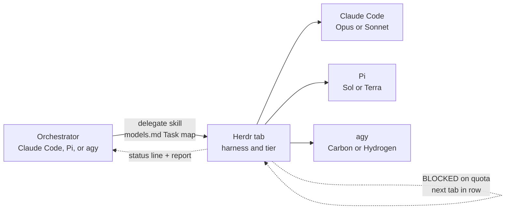

# Personal agent configuration

Source of truth for coding-agent behavior, tuned for Claude Opus 5.5. `AGENTS.md` is the always-on instruction file; everything else loads on demand. Claude Code, Pi, and Antigravity (`agy`) are thin adapters.

```text
AGENTS.md      always-on defaults: communication, scope, playbook routing, delegation, safety
rules/         coding — read by the agent before writing code
skills/        <intent>/<skill>/SKILL.md, installed flat by skill name
  playbooks/   investigation, bugfix, feature, perf, ship, long-run (routed by AGENTS.md)
  understand/  how, why, recall, teach, auto-research
  clarify/     sharpen
  design/      arena, model-the-domain, make-operations-idempotent
  build/       tdd, typescript-best-practices
  verify/      code-review, blast-radius, interrogate, benchmark-checklist, statechart,
               create-/maintain-verification-skill, create-/maintain-formal-verification-skill
  write/       unslop, technical-writing, ketchup, bro
  learn/       evidence-learning-loop, reflect, correct
  operate/     delegate
  tools/       jj, agent-browser, notion-mcp
claude/        harness.md, subagent definitions, delegate tab deny list
pi/            harness.md, subagent definitions, settings.json, subagent runtime config
agy/           harness.md, delegate tab deny list
models.md      model and effort per harness tier, task routing, evidence
bin/           model-usage: per-model delegate stats from session logs
install.sh     publishes one git commit as ~/.agents/src and links harnesses to it
```

Project-specific commands and conventions belong in each project's own `AGENTS.md`. Secrets and machine-local permissions do not belong here.

## Install

```sh
./install.sh --dry-run          # preview
./install.sh claude pi agy      # selected adapters (default: all)
./install.sh --with-settings pi
```

Installing is publishing. `./install.sh` exports a commit with `git archive` into a read-only `~/.agents/releases/<sha>/`, then points `~/.agents/src` (override with `AGENT_SRC`) at it in one rename. Harness links point into `~/.agents/src`, so they never change. Only the commit last installed is live, and no edit is live until it is committed and installed. Without `--rev` the installer installs `HEAD` and refuses a dirty working tree; `--rev <commit>` installs any commit, which is also how to roll back. It fails on duplicate skill names across intents, backs up any file it replaces under `${XDG_STATE_HOME:-~/.local/state}/agent-config-installer/backups/` (keeping the 10 newest timestamped runs and any other folder, such as `manual-*`), and removes only dangling links into `~/.agents/src`.

```sh
git commit -am "..." && ./install.sh   # go live with HEAD
./install.sh --rev <older-commit>      # roll back
```

| Source | Installed to |
|---|---|
| `skills/<intent>/<skill>`, `rules/*` | `~/.agents/skills/<skill>`, `~/.agents/rules/` (skills also to `~/.claude/skills/<skill>` and `~/.gemini/config/skills/<skill>`) |
| `AGENTS.md` | `~/.claude/CLAUDE.md`, `~/.pi/agent/AGENTS.md`, `~/.gemini/config/AGENTS.md` |
| `claude/agents/*.md` | `~/.claude/agents/` |
| `pi/agents/*.md`, `pi/subagents.json` | `~/.pi/agent/agents/`, `~/.pi/agent/extensions/subagent/config.json` |
| `agy/plugins/*` | `~/.gemini/config/plugins/` |

Settings are opt-in (`--with-settings`) because replacing them can disable local hooks or permissions. Restart agent sessions after installing.

## Models

[`models.md`](models.md) holds the model and effort for each harness tier, which tab takes each task type, the evidence, and the review procedure. In short:

- **Orchestrator:** the session you steer, normally Claude Code on Opus 5.5, designs and builds the main work, then asks another family to review its design, code quality, or security. Opus is not allowed in Pi.
- **Delegates:** inside Herdr, the `delegate` skill runs `researcher` and `worker` work in a thinking or fast tab of Claude Code, Pi (GPT-6.1), or agy (Gemini 4), chosen by task type. Cross-family seats (`arena`, `interrogate`, `reflect`) take any family other than the author's.
- **Out of quota:** a tab that hits a usage limit is marked blocked for the session and its work goes to the next tab in its Task map row; with every other harness blocked, the orchestrator does the work itself. When the orchestrator's own harness hits its limit, continue in a Pi or agy session; the same skills and `models.md` apply there.
- **Coordination:** delegation is a conversation between models, guided by patterns rather than limits. Any agent may delegate, in a Herdr tab you can watch (a native subagent only when no tab fits), and quality comes before cost. Each concurrent writer works in its own git worktree and branch, and one integrator merges them; see [`delegate`](skills/operate/delegate/SKILL.md).



## Editing

Edit here, never the installed copies. Keep every line behavior-changing: no emphasis words, no duplicated rules, no instructions the model follows by default. Review config changes like code; a global instruction affects every repository.

Many skills and playbooks are adapted from [pstack](https://github.com/cursor/plugins/tree/main/pstack) (MIT, Lauren Tan; notice in `LICENSE`); `docs/agent-flow/intent.md` records each adoption decision.

Released under the [MIT License](LICENSE).
