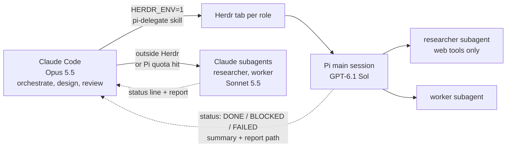

# Personal agent configuration

Source of truth for coding-agent behavior, tuned for Claude Opus 5.5. `AGENTS.md` is the always-on instruction file; everything else loads on demand. Claude Code and Pi are thin adapters.

```text
AGENTS.md      always-on defaults: communication, scope, playbook routing, delegation, safety
rules/         coding — read by the agent before writing code
playbooks/     bugfix, feature (intent <-> design <-> code)
skills/        jj, code-review, evidence-learning-loop, auto-research, pi-delegate, agent-browser, notion-mcp
claude/        researcher and worker subagents (fallback outside Herdr)
pi/            subagent definitions, settings.json, runtime limits
install.sh     idempotent copy installer
```

Project-specific commands and conventions belong in each project's own `AGENTS.md`. Secrets and machine-local permissions do not belong here.

## Install

```sh
./install.sh --dry-run          # preview
./install.sh claude pi          # selected adapters (default: all)
./install.sh --with-settings pi
```

The installer copies files (never symlinks), backs up anything it replaces under `${XDG_STATE_HOME:-~/.local/state}/agent-config-installer/backups/`, and never deletes. Files removed from this repo stay installed until you remove them by hand.

| Source | Installed to |
|---|---|
| `skills/*`, `rules/*`, `playbooks/*` | `~/.agents/` (skills also to `~/.claude/skills/`; Pi reads `~/.agents/skills`) |
| `AGENTS.md` | `~/.claude/CLAUDE.md`, `~/.pi/agent/AGENTS.md` |
| `claude/agents/*.md` | `~/.claude/agents/` |
| `pi/agents/*.md`, `pi/subagents.json` | `~/.pi/agent/agents/`, `~/.pi/agent/extensions/subagent/config.json` |

Settings are opt-in (`--with-settings`) because replacing them can disable local hooks or permissions. Restart agent sessions after installing.

## Models

- **Orchestrator and thinker:** Claude Opus 5.5 at `medium` effort in Claude Code, for planning, design, review, and final judgment; set the effort in your own Claude Code settings. Opus is not allowed in Pi.
- **Other roles:** Pi on GPT-6.1 Sol (`openai-codex/gpt-6.1-sol`, thinking `medium`; `scout` keeps `low`), started by Claude Code in Herdr tabs through the `pi-delegate` skill as `researcher` and `worker`. A task that fails twice is retried at `xhigh`, then taken over by Opus.
- **Backup:** outside Herdr or when Pi hits its quota, Opus does small tasks itself and the Claude Code subagents take larger ones: `worker` on Sonnet 5.5 `high`, `researcher` on Sonnet 5.5 `medium`. Pi has no automatic fallback; pi-subagents 0.76 removed `fallbackModels`.
- **Last resort, manual:** when Claude usage is also exhausted, run Pi or Gemini CLI on Gemini 4 Argon (`high`) yourself. No Google provider is configured here.
- **Why:** on the Artificial Analysis Coding Agent Index (October 2026), GPT-6.1 Sol `medium` scores 61 at $0.70 and 11 minutes per task, against 55 at $1.24 and 12 minutes for Sonnet 5.5 `high`, 55 at $6.35 for GPT-5.6 Sol `max` (the previous Pi model), 63 at $3.33 and 27 minutes for Sonnet 5.5 `xhigh`, and 64 at $5.84 and 35 minutes for Gemini 4 Argon. Haiku 5.5 scores at most 41 and is not used.



## Editing

Edit here, never the installed copies. Keep every line behavior-changing: no emphasis words, no duplicated rules, no instructions the model follows by default. Review config changes like code; a global instruction affects every repository.

Released under the [MIT License](LICENSE).
