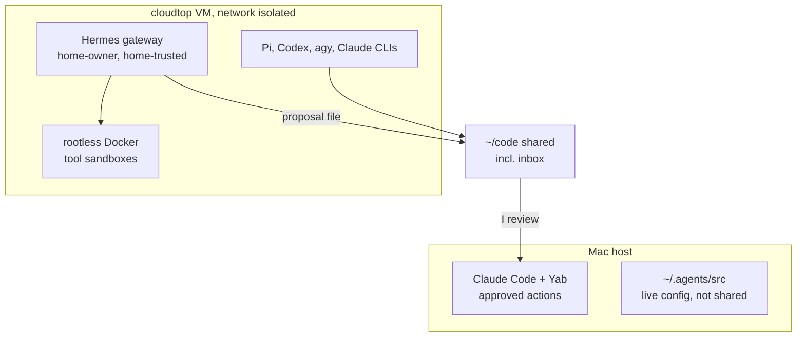

# Design: run agents in the cloudtop VM by default

Status: draft. Evidence: checks on 2026-11-08 against OrbStack 2.2.3, Hermes v0.23.0+1319, and the `harness-containment` research report. Claims marked UNVERIFIED have not been checked by a run.

## Requirements

- R1. From `cloudtop`, no TCP port on the Mac or the LAN is reachable; public internet and the OrbStack DNS resolver are.
- R2. The VM user that runs agents has no sudo and no root-equivalent group (`docker`, `lxd`).
- R3. The only Mac path in the VM is `~/code`, mounted at `/home/simo/code`.
- R4. Harnesses in the VM are installed by `_agent/install.sh` and hold only model credentials.
- R5. Herdr opens a tab in the VM with one command, and on the Mac by default only when asked.
- R6. Hermes runs in the VM on rootless Docker, with profiles `home-owner` and `home-trusted` behind one Telegram bot.
- R7. Account actions run on the Mac only, after my approval of a proposal Hermes wrote.

## Layout



## Current state of cloudtop

| Check | Result |
|---|---|
| `isolated` | true; `/mnt/mac` absent; `mac uname` fails with `dial: no such file or directory` |
| `isolate_network` | was false; Mac loopback ports (Chrome CDP 9333, agent-browser 53159, Raycast 7265, Postgres 5432) were reachable through `host.orb.internal`. Set to true on 2026-11-08; all now closed |
| Mac LAN address `192.168.1.173` | reachable after `isolate_network` (ports 22, 3000, 5000, 7000); blocked for `simo` and containers by `agent-egress.service` (R1) |
| Mounts | `/Users/simo/code:/home/simo/code`, read-write. `cloud-secrets/` moved to `~/.secrets` on the Mac |
| User `simo` | sudo removed: `/etc/sudoers.d/orbstack` moved to `/root/sudoers-removed/`, `simo` out of group `sudo`; survives restart. Group `orbstack` owns no files on the root filesystem |
| Docker | `docker.io` 29.1.3 rootless as `simo` (user unit, linger on, context `rootless`); rootful `docker.service`, `docker.socket`, `containerd.service` disabled. `dockerd-rootless*.sh` linked from `/usr/share/docker.io/contrib` into `/usr/local/bin` |
| `forward_ssh_agent` | false |
| Harnesses | Claude Code 2.1.250, Pi 0.84.4; Codex, agy, Hermes, uv absent |
| DNS | `nameserver 0.250.250.200` |
| OrbStack (Mac) | 2.2.5 via Homebrew cask; `docker.expose_ports_to_lan`, `machines.expose_ports_to_lan`, `k8s.enable` false; all Docker ports bind `127.0.0.1` |

## R1: egress policy

`isolate_network` blocks the `host.orb.internal` route only. Traffic to the Mac's LAN address leaves through NAT and comes back. A root-owned nftables table, loaded by a systemd unit at boot, drops output to private and local ranges for every UID except root:

```nft
table inet agent_egress {
  chain output {
    type filter hook output priority 0; policy accept;
    meta skuid 0 accept
    ip daddr 0.250.250.200 udp dport 53 accept
    ip daddr 0.250.250.200 tcp dport 53 accept
    ip daddr { 10.0.0.0/8, 172.16.0.0/12, 192.168.0.0/16, 100.64.0.0/10, 169.254.0.0/16, 0.250.250.0/24 } drop
    ip6 daddr { fc00::/7, fe80::/10 } drop
  }
}
```

Rootless Docker sends container traffic from `simo`'s user namespace (pasta or slirp4netns), so the same `skuid` rule covers it (UNVERIFIED). A domain allow list is out of scope for v1; the open internet stays reachable for web research.

## R2: privilege

- Remove `simo`'s sudo. Admin work runs from the Mac as `orb -m cloudtop -u root <cmd>`, which needs no password in the VM.
- Install Docker rootless for `simo` (`dockerd-rootless-setuptool.sh`), with no rootful daemon and no `docker` group.
- The nftables unit and `/etc/sudoers.d` are root-owned; `simo` cannot change them.

## R3: what crosses the shared folder

Files written in the VM can run on the Mac later. These paths are the risk, with the rule for each:

| Path | Rule |
|---|---|
| `.git/hooks`, `.jj` config, `.envrc`, `package.json` scripts, `.vscode/tasks.json` | On the Mac, run `jj`/`git` with hooks off for repos an agent in the VM touched (UNVERIFIED which repos need it); direnv stays off for `~/code` |
| `~/code/_agent` | The Mac's live config is `~/.agents/src`, outside `~/code`. A change made in the VM goes live only after I review the jj change and update `~/.agents/src` |
| Credentials | Never under `~/code`; `cloud-secrets` lives in `~/.secrets` |

## R4: harness install in the VM

1. As root: install Node, uv, jj, Docker rootless prerequisites (`uidmap`, `passt`), nftables.
2. As `simo`: `jj workspace add ~/.agents/src` from `~/code/_agent`, then `./install.sh`. The installer is POSIX `sh` and its paths are `$HOME`-relative; a Linux run is UNVERIFIED.
3. Install or update Claude Code, Pi, Codex, agy, and Hermes at the Mac's versions.
4. Sign in each harness inside the VM (browser OAuth on the Mac, device code where offered). These are the only credentials in the VM.

## R5: Herdr tabs

Herdr stays on the Mac. A VM tab is a Mac pane whose shell runs `orb -m cloudtop`:

```sh
herdr tab create --workspace "$HERDR_WORKSPACE_ID" --label vm --cwd ~/code/<repo>
herdr pane run <pane_id> 'orb -m cloudtop -w /home/simo/code/<repo>'
```

Whether Herdr recognizes a Pi or Claude agent running inside `orb` for `herdr agent` commands is UNVERIFIED; if not, `delegate` uses `herdr pane` commands for VM tabs.

## R6: Hermes in the VM

Config keys come from the installed source (`hermes-agent` at 8422e54); citations are in the session research notes.

- One bot token, in the default profile's `.env` in the VM. Routing in `~/.hermes/config.yaml`:

  ```yaml
  gateway:
    multiplex_profiles: true
    profile_routes:
      - {name: owner,  platform: telegram, user_id: "<MY_ID>", profile: home-owner}
      - {name: family, platform: telegram, profile: home-trusted}
  ```

- Allowlist with `TELEGRAM_ALLOWED_USERS` (me and named family); `unauthorized_dm_behavior: ignore`; `allow_admin_from` is my ID only, so family cannot run `/yolo`.
- Both profiles: `terminal.backend: docker`, `docker_network` on, no `docker_volumes` except the inbox (decision 3), `skills.disabled: [claude-code, codex, computer-use]`, `skills.write_approval: true`, `memory.write_approval: true`, `kanban.auto_decompose: false`.
- `home-trusted`: `agent.disabled_toolsets: [terminal, code_execution, browser, computer_use, delegation, cronjob, session_search, kanban]`. Approval prompts go to whoever is chatting, so this profile gets no tool that asks for approval.
- `home-owner`: terminal, code execution, and browser enabled inside the container; `approvals.mode: manual`.
- `hermes pm install --without cua-driver` in both profiles.
- Never: `-z`, `--yolo`, `approvals.mode: off`.

## R7: approval hop

Hermes writes a proposal to `~/code/home-agent/inbox/<date>-<slug>.md`. Its first line is `status: PROPOSAL`, followed by the action, the exact recipients, amounts, dates, and the text to send. Claude Code on the Mac reads the inbox when I ask. It shows me the proposal and acts through Yab, whose mail and payment steps already wait for my yes. The proposal is data: Claude Code never runs commands from it.

## Plan

1. Done 2026-11-08: `cloud-secrets` moved to `~/.secrets/cloud-secrets` (mode 700/600).
2. Done 2026-11-08: nftables unit (R1), sudo removed and rootless Docker (R2). Checked after restart: from `simo` and from an `alpine` container, `192.168.1.173:22`, `192.168.1.173:3000`, `192.168.1.1:80`, and `0.250.250.254:9333` are blocked; `https://api.openai.com` returns 401; `sudo -n true` fails.
3. Done 2026-11-08 except Hermes: npm prefix `~/.local`; Claude Code 2.1.319 (native), Pi 1.5.0, Codex 0.167.0, agy 1.5.3 (GitHub release `agy_cli_linux_arm64`), uv 0.13.7; `libatomic1` and `ripgrep` as root. jj workspace `cloudtop` at `~/.agents/src` on `main`; `./install.sh` linked; seven dangling links from the old layout removed. Hermes: run its installer with `--skip-setup --skip-computer-use --skip-browser` as `simo`.
4. I sign in each harness in the VM.
5. Herdr: open a VM tab and check `herdr agent start --kind pi` inside it (R5).
6. Hermes: profiles and routing (R6), Telegram token entered by me, then tests. A family-ID message reaches `home-trusted`, and asking it to run `uname` gets a refusal or no tool. A message from me reaches `home-owner`.
7. Approval hop (R7) with a trip-planning dry run.

## Open decisions

1. Inbox mount for Hermes containers: mounting a host path brings approval prompts back for that profile's terminal (`tools/approval.py:1123-1128`). Alternative: the gateway writes proposals, and containers get no mount.