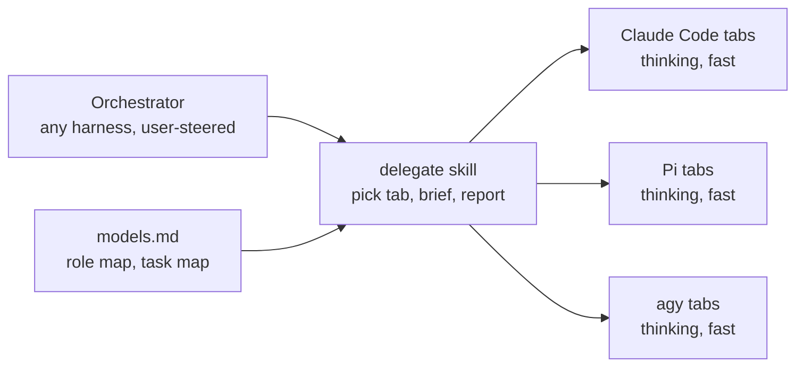
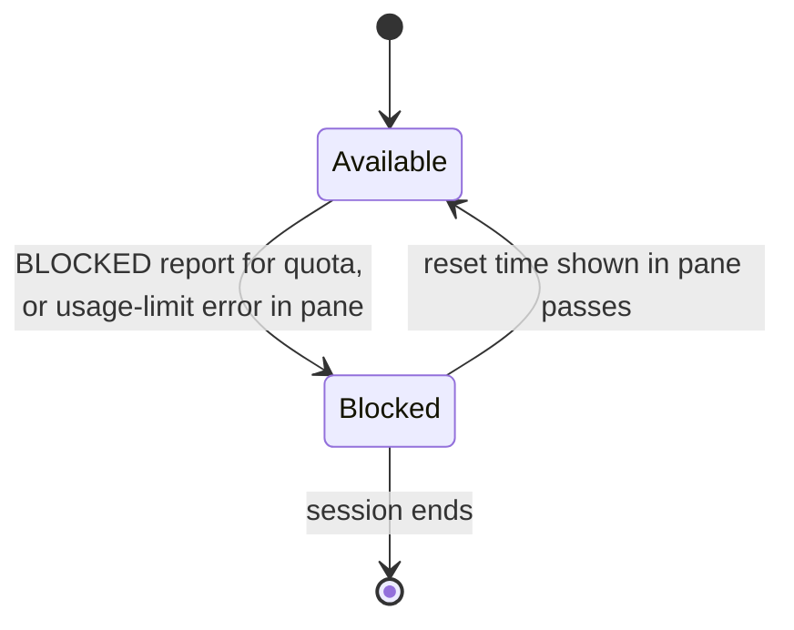

# Design: delegate tabs across Claude Code, Pi, and agy

Status: plan steps 1 to 3 done 2026-11-14; steps 4 and 5 pending. Intent: [`intent.md`](intent.md). Claims marked UNVERIFIED have not been checked by a run.

Evidence: recommendations from a Claude Code tab (Opus 5.5) and a Pi tab (GPT-6.1 Sol, `high`) given the same brief on 2026-11-13, research by Pi and agy the same day, and the tab runs observed in that session. agy's own recommendation is missing because its tab stopped at a file-access prompt. On 2026-11-14 Claude, Pi, and agy tabs, asked whether to cut to two harnesses, all recommended dropping agy. The user keeps it (Alternatives, A1) and asked for routing by which model does each task type best.

## Objective

Delegated work runs on whichever of three model families does that kind of task best: Claude Code (Anthropic), Pi (OpenAI through the ChatGPT subscription), and agy (Google). Each family has its own paid subscription and quota. When one or two subscriptions run out, work moves to the ones that still have quota, and the user can continue from any harness's session.

### Requirements

- R1. A `delegate` skill starts a named Herdr tab for any harness and tier, sends a brief, waits, reads the report, and closes the tabs it created.
- R2. Each harness has a thinking tier and a fast tier. Model IDs and efforts live only in `models.md`, except config files a harness reads directly, which `models.md` lists.
- R3. Every report starts with `status: DONE | BLOCKED | FAILED`, then a `harness:` line with the harness, model, and effort, and a `task:` line naming its Task map row.
- R4. A delegate tab knows it is a delegate. It does not start Herdr agents and does not push, merge, open PRs, or move bookmarks. Claude Code and Pi delegates may use in-harness subagents; agy runs single-agent in every role.
- R5. `arena`, `interrogate`, and `reflect` ask for a seat from another family through `delegate` instead of naming Claude or Pi.
- R6. A tab is quota-blocked when its report says `status: BLOCKED` for quota or its pane shows a usage-limit error. The orchestrator then skips that harness for the session, or until the reset time the pane shows, and sends the brief to the next tab in the Task map row. With no tab left, fast work runs in the main session and a cross-family seat is skipped by name.
- R7. The orchestrator routes each task by the Task map in `models.md`. The task type picks the tier and an order of tabs; equals go to the subscription with more quota left; the order changes only on per-task-type evidence.
- R8. Research that needs several sources goes to all three fast tabs in parallel with the same question, because each harness searches a different engine. The merged report lists a claim as a finding when sources from at least two engines support it, marks it single-engine otherwise, and reports conflicts between engines as open questions. A seat that returns `BLOCKED` on quota is not rerouted; the report names the missing engine.

### Non-goals

- Codex and Hermes (Alternatives, A2 and A3).
- A cap on concurrent delegate tabs (intent, open question 2).
- Automatic switching of the orchestrator's own harness. When the orchestrator's subscription runs out, the user starts a session in another harness.

### Success criteria

- From any harness, one task each to `claude-fast`, `pi-thinking`, and `agy-fast` returns a parseable report and closes its tab.
- A delegate tab asked to start another Herdr agent refuses.
- With one harness's quota exhausted, a fast task reaches the next tab in its row without the user's help, and the user is told once.
- `arena` runs with three families and names the model behind each seat.

## Design

The session the user steers is the orchestrator, in any harness. It loads the `delegate` skill, looks up the task's row in the `models.md` Task map, and starts the first tab in that row that is not blocked. The tab gets a delegate contract and a self-contained brief, and replies with a status-lined report. The orchestrator treats the report as a claim and reruns its decisive command.



The design keeps working when subscriptions run out:

| Out of quota | Result |
|---|---|
| One delegate harness | Its rows fall through to the next tab; cross-family seats use the remaining other family. |
| Two delegate harnesses | Fast work goes to the last harness or the main session; cross-family seats use the one other family left, or are skipped by name. |
| The orchestrator's harness | The user continues in a Pi or agy session; `delegate` and `models.md` read the same there, and the new orchestrator's own fast tab moves last. |
| All three | Nothing runs; the user waits for a reset. |

## Detailed design

### Role map and task map

`models.md` at the repo root holds the role map (model, default effort, and retry effort for each harness and tier), the task map (for each task type, the tier and the order of tabs to try), the benchmark and real-use evidence behind both, and the review procedure. No other file in this design names a model ID.

The task map starts with `pi-fast` and `agy-fast` as equals on every fast row, on the user's assumption that Hydrogen matches Sonnet 5.5 and Sol. Quota headroom breaks the tie: `codexbar usage --format json` when installed, otherwise the first tab. `claude-fast` comes last in fast rows because it spends the orchestrator's quota; when the orchestrator is not Claude Code, its own family's fast tab moves last instead. Plan step 4 reorders a row only if timed runs contradict the assumption.

Every task starts at the tier's default effort. After two failures it retries on the same model at the retry effort in a new tab; after that, the orchestrator takes it over.

### Tab lifecycle

```sh
herdr tab create --workspace "$HERDR_WORKSPACE_ID" --cwd "$PWD" --label pi-fast --no-focus
herdr agent start pi-fast --kind pi --pane <pane_id> -- <start arguments>
herdr agent prompt pi-fast "<brief>" --wait --timeout 600000
herdr agent read pi-fast --source recent-unwrapped --lines 200
herdr tab close <tab_id>
```

Start arguments per harness; every flag appears in the CLI's `--help`:

| Harness | Arguments after `--` | Delegate marker | Report source |
|---|---|---|---|
| Claude Code | `--model <id> --effort <level> --permission-mode auto --name <tab> --settings ~/.agents/src/claude/delegate.json --append-system-prompt "<contract>"` | `--append-system-prompt`; `claude/delegate.json` denies `git push`, `jj git push`, `gh pr create`, `gh pr merge`, `jj bookmark` | pane |
| Pi | `--model <id>:<level> --session-id <uuid> --append-system-prompt "<contract>"` | `--append-system-prompt` (Pi 1.5) | last assistant message in `~/.pi/agent/sessions/--<cwd>--/*_<uuid>.jsonl`, because the pane can stay scrolled to an earlier reply |
| agy | `--model <id> --effort <level> --mode auto --settings ~/.agents/src/agy/delegate.json` | first paragraph of the brief; `agy/delegate.json` has the same deny list; the `no-subagents` plugin blocks `invoke_subagent`, `define_subagent`, `swarm`, and `run_workflow` | pane |

agy runs single-agent because its subagents and background tasks let the parent turn go idle and race `herdr agent prompt --wait`.

Observed startup behavior, 2026-11-13 and 2026-11-14: Claude Code started and answered with no prompt. Pi started and answered. agy in plan mode asked before every command; in auto mode it asked once to read a file outside the workspace, asked for trust once per new folder, and warned at startup that the sign-in lacks a permission. agy `--settings` rejects `$schema` and accepts `permissions.deny`.

### Delegate contract

The contract is the same text in every harness:

> You are a delegate. Do not start Herdr agents or delegate to another harness. Do not push, merge, open PRs, or move bookmarks. Start your final reply with `status: DONE | BLOCKED | FAILED` (BLOCKED with the reason, `quota` when a usage limit stopped you), then lines `harness: <name> <model> <effort>` and `task: <Task map row>`, a 1-3 line summary, what changed or ran with exact commands and real output, and anything unexpected. Wait for your subagents and background tasks before the final reply. Write a long report to the path the brief gives.

Without the first sentence, a Claude delegate in a Herdr tab reads the AGENTS.md Delegation line, sees `HERDR_ENV=1`, and opens tabs of its own. The status line comes ahead of the `Playbook:` line AGENTS.md asks for, so the orchestrator can parse it. The brief holds the goal, exact files, steps, done-when, the Task map row, and the tab's harness, model, and effort.

The orchestrator:

- On `agent_not_ready` or `blocked`, reads the pane and asks the user before answering a trust, approval, or sign-in prompt. It never adds an auto-approve flag.
- On a timeout or stall, reads the pane before resending.
- Treats each report as a claim and reruns the decisive command.
- Closes only the tabs it created, when the role has no more work.

### Quota

A harness out of quota often cannot write a report, so detection reads the pane as well as the report.



Each harness is `Available` or `Blocked` for the orchestrator's session; the orchestrator owns this list and keeps it in its context. Events and rules:

- A `status: BLOCKED` report naming quota, or a usage-limit, rate-limit, 429, or quota error in the pane, moves the harness to `Blocked`. The orchestrator closes the tab, records the reset time if the pane shows one, sends the same brief to the next tab in the row, and tells the user once.
- A timeout or stall alone does not block a harness; the orchestrator reads the pane first.
- A delegate's subagent that hits a limit surfaces it to the tab: pi-subagents returns a 429 from the resolved model and never switches models (pi-subagents `docs/models.md`).
- Never reroute inside an `auto-research` fan-out; the report names the missing engine (R8).
- Never route a cross-family seat to the author's family; with no other family left, the skill reports the seat as skipped, for example "not interrogated".
- Never retry a blocked harness before its reset time in the same session.

### Orchestration

Whichever session the user steers is the orchestrator, in any harness, and delegation is one level deep. A Claude Code or Pi delegate may use its own subagents; agy never uses subagents, workflows, or swarms, and no delegate starts a Herdr agent. This replaces the 2026-11-08 rule "no delegate drives another harness", which conflicted with multi-agent intent decision 2 (Alternatives, A4).

### Research fan-out

Claude Code's web search runs on Brave (Anthropic subprocessor list; Simon Willison, 2025-03-21). Pi's `web_search` uses OpenAI search through the ChatGPT subscription when `~/.pi/web-search.json` sets `"provider": "openai"`. agy grounds on Google (third-party write-ups, UNVERIFIED). `auto-research` sends each question to the three fast tabs and merges by R8. A fan-out costs three fast tasks of quota, so a single lookup stays on one tab.

### Pi subagent models

Pi subagents follow the tab's model so a `pi-fast` tab does not spend Sol on its subagents. `pi/settings.json` leaves `subagents.defaultModel` unset and allows Sol and Terra in `subagents.modelScope`; `pi/agents/researcher.md` uses `model: inherit`. pi-subagents does not inherit the parent's thinking level, so subagents run at `defaultThinking` `medium`.

### Usage review

`bin/model-usage` reads Claude Code (`~/.claude/projects/*/*.jsonl`) and Pi (`~/.pi/agent/sessions/*/*.jsonl`) session logs. A run is a top-level session whose last reply starts with a status line. It prints runs, DONE rate, median minutes, and tokens per completed task per harness, model, effort, and Task map row, for the `models.md` review.

### Changes by file

| File | Change | Requirement |
|---|---|---|
| `skills/operate/delegate/SKILL.md` | new; replaces `skills/operate/pi-delegate/SKILL.md` | R1, R2, R3, R6, R7 |
| `AGENTS.md`, Delegation | name `delegate`; skip delegation when the prompt says "You are a delegate"; forbid agy subagents, workflows, and swarms | R4 |
| `claude/delegate.json`, `agy/delegate.json` | deny lists for delegate tabs, passed with `--settings` | R4 |
| `agy/plugins/no-subagents/` | `PreToolUse` hook plugin denying agy subagent tools | R4 |
| `install.sh`, `agy/README.md` | `agy` target linking `AGENTS.md`, `skills/`, and `plugins/no-subagents` into `~/.gemini/config/` without touching `hooks.json` | R1, R4 |
| `skills/verify/interrogate`, `skills/design/arena`, `skills/learn/reflect` | a seat from another family through `delegate`, with a rule for no family left | R5, R6 |
| `skills/understand/auto-research/SKILL.md` | three-engine fan-out and merge | R8 |
| `pi/settings.json`, `pi/agents/researcher.md`, `pi/README.md` | subagents inherit the tab's model; record the OpenAI search provider | R2, R8 |
| `README.md`, Models | link to `models.md` instead of naming models | R2 |
| `bin/model-usage` | per-model run statistics from session logs | R2, R7 |

## Alternatives considered

### A1. Two harnesses: drop agy

All three tabs recommended this on 2026-11-14. It removes one adapter, the agy sandbox and sign-in issues, and the only fast model with no benchmark score (Hydrogen).

It costs the Google subscription, which is paid and reachable only through agy: Pi 0.71.0 removed its Antigravity login (Pi CHANGELOG). It also removes the third quota pool, which is what keeps delegation running when one subscription is out, and the third search engine for R8.

Decision: keep agy. Revisit when plan step 4 shows agy's DONE rate below Pi's on the same rows, or if the agy sandbox cannot run shell commands.

### A2. Headless one-shot runs with a schema-checked report

The 2026-11-08 draft ran Codex (`codex exec -p <role> --output-schema`) and agy (`agy -p --json-schema`) headless through a `delegate run` command, with a per-role sandbox, an exit code per status, and a `ledger.jsonl` usage ledger. That gives a machine-checked report and no pane parsing.

It costs mid-run steering and watching from Remote Control, and needs two delegation mechanisms beside Pi's tabs. Codex shares Pi's ChatGPT quota and model family, so it adds no quota for fallback. The ledger needs every run to write a record; the harness logs already hold the same data.

Decision: Herdr tabs for every harness; drop Codex, the report schema, and the ledger. Revisit if pane parsing proves unreliable after plan step 4.

### A3. Hermes as an always-on operator

Hermes would run scheduled read-only watchers, digests, and Telegram summaries. It shares the ChatGPT quota, and Telegram messages turned into kanban cards are an instruction channel nobody reviews. Remote Control already covers steering from the phone.

Decision: deferred. If revived, keep it outbound only (alerts and read-only watchers).

### A4. Claude Code as the only orchestrator

Keeping `pi-delegate`'s rule, where only Claude Code delegates, means one skill and one set of start arguments to maintain.

It makes Claude's subscription a single point of failure: when it runs out, delegation stops and the fallback subagents stop with it, because they spend the same quota. A Pi-authored change also cannot get a Claude seat for `interrogate`.

Decision: any harness orchestrates, one level deep.

### A5. Fallback inside one harness

pi-subagents had `fallbackModels` until 0.76, and Claude Code's subagents could drop to a smaller Claude model. Quota is per subscription, not per model, so a fallback inside one harness draws on the same exhausted pool.

Decision: reroute across subscriptions (R6).

### A6. Check quota before every task

Probing quota first (CodexBar, `agy /usage`) would avoid starting a tab that is about to fail. CodexBar is not installed, its agy probe is experimental, and a probe per task adds a step to every delegation.

Decision: detect on failure, and use CodexBar only to break ties between equal tabs when it is installed. The cost is one failed start per blocked harness per session.

### A7. Fixed roles per harness

Assigning each harness a role (Claude designs, Pi works, agy researches) is simpler to remember. The benchmark shows the models differ by task type, not by role, and a fixed role leaves no order to fall back through.

Decision: route by task type through the Task map, reordered only on evidence (R7).

## Plan

1. Write `skills/operate/delegate/SKILL.md` with the call sites, contract, quota rules, and per-harness start arguments; delete `pi-delegate`.
2. Update AGENTS.md Delegation, `claude/delegate.json`, the three cross-family skills, `auto-research`, the Pi subagent model settings, the READMEs, and `bin/model-usage`.
3. Smoke runs: one task per harness on its fast tier returns a status-lined report; a delegate asked to start a Herdr agent refuses (R1, R3, R4).
4. Time one task of each fast Task map row on `pi-fast` and `agy-fast`, and one on agy Carbon against Argon, and record the results in `models.md` (R2).
5. One `arena` frontend task across the three thinking tiers; record the winner in the Task map's UI row.

Steps 3 to 5 spend quota on all three subscriptions and need approval.

Step 3 ran on 2026-11-14 from the repo paths, one fast tab per harness. Each tab returned `status: DONE` with `harness:` and `task:` lines and refused to start a Herdr agent. `jj bookmark list` was denied in Claude Code and agy by their `delegate.json` and ran in Pi, which has no deny list. Pi's report read cleanly from its session JSONL. Pi could not see its own model and effort, so the brief now states them.

## Concerns

- agy sign-in: the permission warning was still present on 2026-11-14. Clear it with `/logout` and a new sign-in before step 3. Owner: user.
- agy paths: decide whether delegate tabs pass `--add-dir` for paths outside the workspace or keep agy to the workspace. Owner: user.
- Search engines: `~/.pi/web-search.json` pins `"provider": "brave"` today, so two of the three seats search the same index until it changes. Owner: user, since the file is machine-local.
- Claude delegate tabs run in auto mode; `claude/delegate.json` is their only push guard.
- agy shell commands fail in delegate tabs: the shell from `/nix/store` cannot load `libpcre2-8.0.dylib` because agy's file-system sandbox blocks `/nix/store` (step 3). File reads work. Fix by allowing `/nix/store` reads in agy's sandbox or giving agy a system shell. Owner: user, since it changes a security setting.
- `bin/model-usage` cannot read agy's conversation blobs, which are protobuf with no published schema; agy outcomes come from the reports the orchestrator read.
