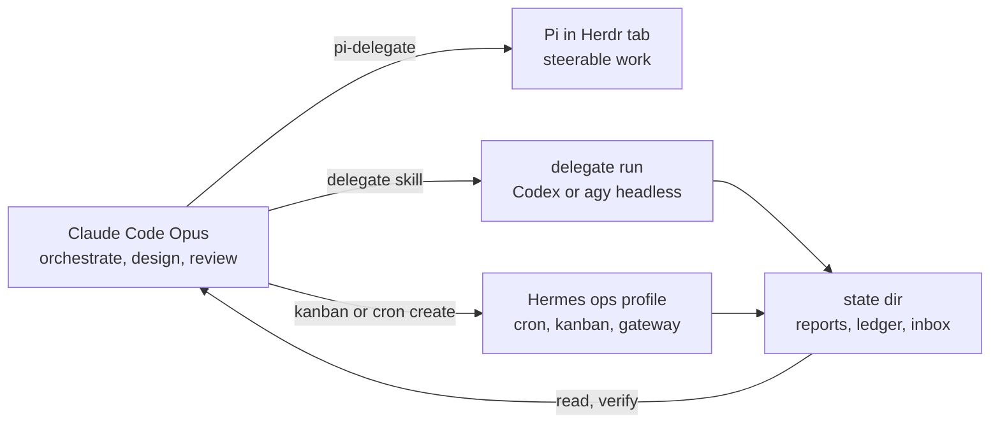

# Design: agy, Codex, and Hermes as delegate harnesses

Status: draft. Evidence: research reports from 2026-11-08 on agy 1.5.3, codex-cli 0.167.0, and Hermes v0.21.5; claims marked UNVERIFIED have not been checked by a run.

## Requirements

- R1. `install.sh` has `agy`, `codex`, and `hermes` components; each links only files this repo owns and leaves runtime-written files local.
- R2. Each harness has one delegation mode that returns a report whose first line is `status: DONE | BLOCKED | FAILED`.
- R3. Each role has an allow list enforced by the harness, and every role denies push, merge, PR creation, and bookmark moves.
- R4. Every headless run appends one usage record; `delegate usage` shows totals per harness and the latest quota windows.
- R5. Hermes runs only as an always-on operator: scheduled and queued read-only jobs, reports to an inbox, summaries to the phone.
- R6. No delegate drives another harness.

## Role map

| Harness | Quota pool | Mode | Roles | Use for |
|---|---|---|---|---|
| Pi | ChatGPT | Herdr tab (`pi-delegate`) | researcher, worker | steerable or long work, as today |
| Codex | ChatGPT (same pool as Pi; UNVERIFIED that both logins are one account) | headless `codex exec -p <role>` | researcher, worker, reviewer | sandboxed one-shot work with a schema-checked report; `codex review` for a second opinion |
| agy | Google | headless `agy -p --agent <role>` | researcher, worker | Gemini-family seat (arena, interrogate) and overflow when ChatGPT quota runs out; replaces the manual Gemini fallback |
| Hermes | ChatGPT | gateway, cron, kanban (`ops` profile) | ops | background digests, PR/CI watchers, phone inbox |

Moving work from Pi to Codex frees no quota. Codex adds an OS sandbox per role and `--output-schema`; agy adds a third model family and a second quota.



## Adapters

| Source | Installed to | Notes |
|---|---|---|
| `AGENTS.md` | `~/.codex/AGENTS.md`, `~/.gemini/AGENTS.md` | Codex reads `~/.agents/skills` natively |
| `codex/{researcher,worker,reviewer}.config.toml` | `~/.codex/` | profiles v2 layer over the local `config.toml` |
| `codex/rules/delegate.rules` | `~/.codex/rules/` | execpolicy `prefix_rule` forbids for the never-list |
| `agy/agents/{researcher,worker}.md` | `~/.gemini/config/agents/` | `tools` and `model` per role; symlinks are listed (VERIFIED-LOCAL) |
| `agy/skills.json` | `~/.gemini/config/skills.json` | points agy at `~/.agents/skills`, excluding `pi-delegate` and `delegate` (UNVERIFIED that skills load) |
| `agy/settings.<role>.json`, `delegate/report.schema.json` | not installed; passed per run | agy rewrites its own `settings.json` |
| `hermes/SOUL.md` | `~/.hermes/profiles/ops/SOUL.md` | operator contract, not `AGENTS.md`, whose coding playbooks conflict with a read-only role |
| `bin/delegate` | `~/.local/bin/delegate` | headless runner and usage ledger |
| `skills/operate/delegate/SKILL.md` | flat skills | Claude side for Codex, agy, and Hermes |

Machine-local, documented in each adapter's `README.md`: `~/.codex/config.toml`, `hooks.json`, `auth.json`; `~/.gemini/antigravity-cli/settings.json`, `config.json`; `~/.hermes/profiles/ops/config.yaml` (Hermes blocks agent writes to it).

## Delegation

Call sites the `delegate` skill teaches:

```sh
delegate run codex worker brief.md      # -> $RUNS/<id>/report.json, exit 0 iff status DONE
delegate run agy researcher brief.md
delegate review codex --base main       # codex review, report in the same shape
delegate usage --days 7
hermes -p ops kanban create "<title>" --assignee ops --body-file brief.md \
  --idempotency-key <topic>-<date> --workspace dir:$INBOX/<id> --max-runtime 1800
```

`delegate run` maps a role to one command line, with `RUNS=${XDG_STATE_HOME:-~/.local/state}/agent-runs`:

- Codex: `codex exec -p <role> --json -o $RUNS/<id>/report.json --output-schema delegate/report.schema.json "$(cat brief.md)"`; events go to `$RUNS/<id>/events.jsonl`.
- agy: `agy -p "$(cat brief.md)" --agent <role> --mode plan|accept-edits --sandbox --settings agy/settings.<role>.json --json-schema delegate/report.schema.json --output-format json --print-timeout 15m`; exit 3 means a timeout or model error.

The brief keeps the `pi-delegate` shape: goal, exact files, steps, done-when, and the report format. Claude treats every report as a claim and reruns the decisive command.

Hermes is never run with `-z` for delegated work: `-z` forces yolo and hook auto-accept (`hermes_cli/oneshot.py:277-283`) and ignores `--worktree`. Kanban workers and cron default to deny on dangerous commands.

## Allow lists

| Harness | Researcher | Worker | Never-list enforcement |
|---|---|---|---|
| Codex | `sandbox_mode = "read-only"`, `web_search = "live"`, `approval_policy = "never"` | `workspace-write`, network off, `approval_policy = "never"` | `delegate.rules` forbids `git push`, `jj git push`, `gh pr`, `jj bookmark`; the sandbox blocks the rest |
| agy | agent `tools` limited to read and web; `--mode plan` | `permissions.allow` for edits in the workspace and listed commands; `--mode accept-edits`, `--sandbox` | `permissions.deny` with `command(regex:...)`; deny wins over allow |
| Hermes | `ops` toolsets: web, file read, terminal for `gh`/`jj` reads | none | `approvals.deny` globs including `git * push*`; no push credentials in the profile; `skills.write_approval: true`; bundled `claude-code`, `codex`, `kanban-codex-lane` skills disabled |

Hermes deny globs match command text only: `python3 -c` with a subprocess push passes under yolo (VERIFIED-LOCAL with `hermes approvals test`). Containment for Hermes is no credentials and no yolo, not the glob list.

## Usage tracking

`delegate run` appends one line per run to `$RUNS/ledger.jsonl`:

```json
{"ts":"…","harness":"codex","role":"worker","model":"gpt-6.1-sol","effort":"medium","status":"DONE","input_tokens":0,"output_tokens":0,"cached_tokens":0,"seconds":0,"report":"…"}
```

| Harness | Per-run tokens | Quota window |
|---|---|---|
| Codex | sum of `turn.completed.usage` in `events.jsonl` | latest `token_count.rate_limits` (5-hour and weekly `used_percent`) in `~/.codex/sessions` |
| agy | `.usage` in the JSON envelope; no cost field | `agy -p "/usage" --output-format json` (UNVERIFIED) |
| Hermes | `hermes -p ops insights --days N`; `state.db` per profile | `hermes usage` |

`delegate usage` reads the ledger, the Codex rollout files, and the two Hermes commands; it never starts a model turn except the agy `/usage` query.

## Hermes operator

Jobs: scheduled research digests (web tools only), PR/CI watchers through cron `--monitor-script` (no model call when the script output is unchanged), read-only `jj log`/`jj st` across `~/code/*`, and bot messages that become `--triage` kanban cards. Every job writes `$INBOX/<date>-<slug>.md` with `INBOX=${XDG_STATE_HOME:-~/.local/state}/agent-inbox/hermes`, first line the status line, and sends a DONE or BLOCKED summary with `hermes send`. Claude reads the inbox and `kanban list --json`; `hermes -p ops pause` stops all dispatch.

Never: push, merge, comment on PRs or issues, move bookmarks; edit `~/code/_agent`, `~/.agents/src`, or any working copy; run `-z`, `--yolo`, `import-agent`, or `profile install <url>`; approve its own commands through `mcp serve`.

Skills: `skills.external_dirs: [~/.agents/src/skills]`, not `~/.agents/skills`. Hermes's external-dir guard resolves real paths, so symlinked skills under `~/.agents/skills` look Hermes-owned to the curator (VERIFIED-LOCAL, `agent/skill_utils.py:627-645`).

Rejected roles: another worker (same quota and model family as Pi, `-z` forces yolo); orchestrator of Claude Code (inverts R6 and adds a second, unreviewed instruction store in Hermes memory); cheap-model router (no non-ChatGPT key configured; revisit with an OpenRouter key).

## Plan

1. Scaffold: adapter dirs, `install.sh` components, `delegate` with `run`/`usage` stubs; `./install.sh --dry-run agy codex hermes` lists the table above.
2. Codex: profiles, rules, report schema; smoke runs per role (R2, R3): a report, a ledger line, `codex execpolicy check` on `git push` returns forbidden.
3. agy: sign in, agents, `skills.json`, settings files; smoke runs per role, including a denied `git push` listed in `denied_actions`.
4. Hermes: `hermes profile create ops`, local config block from `hermes/README.md`, `hermes -p ops approvals test -- "git -C /x push"` exits 3, one cron digest lands in the inbox (R5).
5. `delegate` skill and README Models section; retire the manual Gemini fallback line.

Steps 2 to 4 spend quota and step 4 changes Hermes config; each needs approval.

## Concerns

- The Hermes install is 21,799 commits behind upstream; upstream `-z` now runs through the gateway. Re-check the Hermes sections after `hermes update`.
- agy's log reports "not logged into Antigravity"; step 3 starts with sign-in.
- Herdr's `--kind codex` and `--kind agy` tabs are not used by this design; headless runs replace them.
