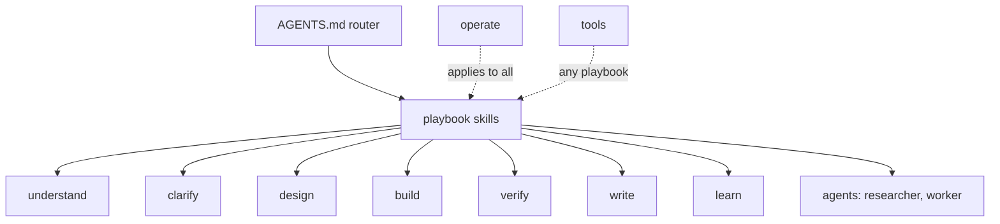

# Intent: reorganize agent settings by intent, using pstack as a reference

Status: draft, awaiting acceptance.

## Problem

My agent settings grew tool by tool: a flat `skills/` folder, two playbooks, one
`rules/coding.md`. pstack (https://github.com/cursor/plugins/tree/main/pstack)
covers far more of the work lifecycle, but it handles things differently from my
flow, so I don't want to copy and paste it. I want a structure where every
skill, playbook, and principle answers one question: which intent is it for?

## Desired outcome

- The repo is organized by intent: the intent is the folder name, and each
  skill or principle is one skill inside that folder.
- My existing workflow (AGENTS.md router, intent.md → design.md → code loop,
  researcher/worker delegation, jj) stays the backbone.
- Each pstack item is reviewed one skill at a time, in discussion, within its
  intent group, and gets a verdict: **adopt**, **adapt** (rewrite into my
  flow), **merge** (into an existing skill), or **skip**.
- Nothing is bulk-merged. Overlapping items start as separate skills; a merge
  is its own reviewed decision.

## Structure

```text
AGENTS.md                      route: style + playbook table (always on)
skills/playbooks/<playbook>/SKILL.md
  investigation  bugfix  feature  perf  ship  long-run
skills/<intent>/<skill>/SKILL.md
  understand/   clarify/   design/   build/   verify/
  write/        learn/     operate/  tools/
claude/agents/, pi/agents/     executors: researcher, worker (+ others if adopted)
```



## Intent map (review backlog)

A `principle-` item becomes a `rules/coding.md` line, plus a disabled skill under its intent folder only when it carries a procedure.

| Intent | Mine today | pstack candidates | Verdict |
|---|---|---|---|
| understand | auto-research | how, why, teach, recall | how: adapt · why: adapt (narrowed) · teach: adopt · auto-research: keep · recall: adapt |
| clarify | (feature.md step 1) | in-your-own-words, sharpen | in-your-own-words: merge (AGENTS.md Communication) · sharpen: adopt (user-invoked) |
| design | (feature.md step 2) | architect, arena, statechart, figure-it-out; principle-foundational-thinking, -model-the-domain, -type-system-discipline, -boundary-discipline, -exhaust-the-design-space, -redesign-from-first-principles, -experience-first, -make-operations-idempotent, -separate-before-serializing-shared-state | architect: adapt (feature.md lines) · exhaust-the-design-space: merge (feature.md) · arena: adopt (user-invoked) · statechart: adopt (user-invoked, in verify/) · figure-it-out: adapt (base of long-run) · principles: decided (see Decisions) |
| build | rules/coding.md | tdd, swarm, typescript-best-practices; principle-laziness-protocol, -subtract-before-you-add, -minimize-reader-load, -migrate-callers-then-delete-legacy-apis, -outcome-oriented-execution, -sequence-verifiable-units | decided (see Decisions) |
| verify | code-review | interrogate, blast-radius, benchmark-checklist, no-comments (+ comment-sicko agent), create-/maintain-verification-skill, create-/maintain-formal-verification-skill; principle-fix-root-causes, -attack-the-premise, -prove-it-works, -test-behavior-not-implementation, -explain-the-number | decided (see Decisions) |
| write | (AGENTS.md Communication) | unslop, technical-writing, ketchup, ketchup-video, bro, show-me-your-work | decided (see Decisions) |
| learn | evidence-learning-loop | reflect, correct, automate-me; principle-encode-lessons-in-structure | decided (see Decisions) |
| operate | AGENTS.md, pi-delegate | poteto-mode (core rules), poteto-help, setup-pstack, poteto-agent; principle-build-the-lever, -guard-the-context-window, -never-block-on-the-human | decided (see Decisions) |
| tools | jj, agent-browser, notion-mcp | (none) | keep |

Playbook backlog, mapped from pstack's 23 playbooks:

| Playbook | Mine today | pstack sources | Verdict |
|---|---|---|---|
| investigation | inline row in AGENTS.md | investigation, session-pickup | pending |
| bugfix | playbooks/bugfix.md | bug-fix | pending |
| feature | playbooks/feature.md | feature, refactoring, prototype, visual-parity, authoring-a-skill, eval | gates + design lines decided (see Decisions); rest pending |
| perf | none | perf-issue, hillclimb, runtime-forensics, trace-forensics | pending |
| ship | none | opening-a-pr, babysit, shipping | pending |
| long-run | auto-research overnight loop | figure-it-out (base, decided), autonomous-run, orchestrate, autopilot-full, autopilot-stack, multi-phase-plan, pause-safely | base decided; rest pending |

Out of scope: benny automations, make-bot-ui, worktree-cleanup.

## Decisions

### loading model

- AGENTS.md is the always-on router: its table lists each playbook and when
  to use it, and the reply names the playbook on the first line.
- Playbooks are skills with `disable-model-invocation: true`: routed only by
  the AGENTS.md table, or forced by me with `/<playbook>` (Pi:
  `/skill:<playbook>`).
- A playbook loads second-layer skills by path at the step that needs them.
  Principles and user-only tools (`sharpen`, `arena`, `statechart`) are
  disabled; only skills with clear observable triggers are model-invoked.
- When one domain's rows crowd the AGENTS.md table, that domain moves to its
  own disabled index skill, and AGENTS.md keeps one row pointing to it.

### understand

- The investigation playbook routes; `how`, `why`, and `auto-research` are
  leaves that do not route to each other.
- `how`: how code works and where things belong, in the current repo or any
  local code directory. In a monorepo too large to read, start from its
  code-search tool. Read-only.
- `why`: the intent behind code, from jj history (descriptions, annotate,
  evolog), committed intent/design docs, and my prompts (this session and past
  session transcripts) only. Date every prompt cited; a later prompt, change,
  or doc overrides an earlier prompt, and conflicts are reported, not resolved
  silently.
- `auto-research`: external, multi-source research only; drop its codebase
  route. Its overnight loop moves to `skills/playbooks/long-run/SKILL.md`, usable by any
  skill.
- `teach`: composes `how`, `why`, and `auto-research` into a paced
  explanation.
- `recall`: where a topic stands, from my recent Claude Code and Pi session
  transcripts plus jj state, before I start or resume it. Status tags are
  jj-based: `[pushed <bookmark>]`, `[local <change-id>]`, `[abandoned]`,
  `[planned]`.

### clarify

- `in-your-own-words`: merged into AGENTS.md Communication, which reports
  progress as start → middle → end:
  - Start: before the first tool call, state the goal and problem as you
    understand them and what you're about to do; don't wait for confirmation.
    Skip for a fully specified small edit.
  - Every subagent brief restates the goal.
  - Start, middle, and end reports use a diagram instead of prose when it
    shows structure, flow, or before/after more clearly.
- `sharpen`: user-invoked only, never loaded by a playbook. Before rewriting
  the prompt, it says what a top professional would do that I didn't ask
  for, the rawest material they'd start from, their methods and tools, and
  what outside check (not me or the agent) shows the result is right. Then it
  rewrites the prompt deeper, not bigger, leaves my choices open, and does not
  do the task.

### design

- `architect`: adapted as feature.md lines, not a skill:
  - Design step: write 2–3 caller call sites first and derive the API or
    proto from them; screen it for two ways to do one task, importable
    internals, hand-synced lists, and split ownership.
  - Code step: start with a scaffold change holding the detailed design's
    types and signatures with `not implemented` bodies.
  - Feedback step: the design is wrong when friction repeats (the same
    workaround in unrelated places, type escape hatches, an unplanned lock,
    two deviations of the same shape).
- `exhaust-the-design-space` and the Prototype playbook's measurable-fork
  part: merged into the design step. When alternatives differ on something
  measurable, build each as a throwaway prototype in scratch and benchmark it
  per `benchmark-checklist` without asking; record each alternative's numbers
  and verdict.
- `arena`: user-invoked only. Runners are a Claude subagent and a Pi worker
  (Sol), each in its own jj workspace or scratch dir with the same grounding;
  only the orchestrator sees the 3–6 criterion rubric. The judge is from the
  family that does not synthesize, and this independent check is allowed
  despite the AGENTS.md no-double-check rule. Pick a base by rubric, graft 1–2
  ideas by hand, verify. Wild divergence means reframe and re-run.
- Design step, for a stateful design: list the states, the events including
  failures (crash, timeout, retry, concurrent actor), and the rules as
  "never X".
- `statechart`: user-invoked, lives at `verify/statechart`, for understanding,
  reviewing, or designing a stateful flow. It runs pstack's `scripts/statechart`
  pinned to cursor/plugins commit 4dd1d058 as an external tool. Each bug path
  is replayed against the real code as a test; a path that does not reproduce
  means the model is wrong.
- `figure-it-out`: adapted as the base of `skills/playbooks/long-run/SKILL.md`, for any
  long task (research, migration, optimization): frame a falsifiable done,
  design the run (units, riskiest first, harness and baseline before work),
  then hypothesis → change → measure → keep or revert, with a judge on
  delegated units and a trail row per unit. Grafted from mine: a budget
  (default 6 h) and cost line at the start, a stop after two units with no
  progress, and scoped claims with STALE from `evidence-learning-loop`
  instead of a bare VERIFIED. Entry checkpoint, trail location, and routing
  are decided in the long-run review.
- Principles: `rules/coding.md` stays the always-on core, one line per
  principle; a principle becomes a disabled skill only when it carries a
  procedure, loaded by path from the step that needs it.
  - `model-the-domain`: new line ("encode the domain in a structure such as a
    state machine, registry, or union instead of another if-branch or a
    second synced boolean"), plus skill `design/model-the-domain` with its
    reach-for list, referenced from the feature design step.
  - `make-operations-idempotent`: new line ("a state-changing operation
    converges from the current state, so running twice or after a crash
    halfway ends the same"), plus skill `design/make-operations-idempotent`
    with its 3-question test and stale-leftover rules, referenced from
    long-run and installer or script work.
  - `type-system-discipline` and `boundary-discipline`: merged into the
    existing pure-logic line: parse external data into types at the
    boundary, trust inside, brand semantic IDs, derive types from the schema
    owner.
  - `separate-before-serializing-shared-state`: merged into the existing
    one-owner line: remove a shared write target before adding a lock.
  - `experience-first`: new line: the user includes the API consumer and the
    next maintainer; every option must earn its place.
  - `redesign-from-first-principles`: the feedback-step scrap line adds
    "redesign as if the requirement were there from the start, and propagate
    to every reference: types, docs, examples".
  - `foundational-thinking`: skipped; covered by usage-first, the scaffold
    step, and the build group's subtract review.

### build

- `tdd`: adopted as disabled skill `build/tdd`, loaded by path from the
  bugfix fix step and the feature code step (one red-green cycle per unit or
  R#). Write the failing test first and confirm it fails for the intended
  reason before changing code; prefer no new test over a bad one (mostly
  mocks, timing, mirrors the implementation); never change a test to match a
  wrong implementation. Unlike pstack's test-then-fix commit stack, test and
  code stay in one jj topic; its description and the report give the
  failing-before and passing-after runs.
- `typescript-best-practices`: adopted, model-invoked when writing
  TypeScript, at `build/typescript-best-practices`.
- `subtract-before-you-add`: the AGENTS.md Scope line changes from "no extra
  features, refactors, abstractions, or cleanup" to: in the system you are
  changing, remove dead or redundant complexity before adding, and leave it
  simpler; build nothing speculative (features, abstractions, validators,
  guards) beyond what is asked.
- `sequence-verifiable-units`: each unit ends green before the next starts.
  `outcome-oriented-execution`: skipped; planned breakage is not allowed.
- `minimize-reader-load`: coding.md line: a new layer or piece of state must
  cut reader load elsewhere by as much; a reader finds where X comes from and
  what changes X quickly.
- `migrate-callers-then-delete-legacy-apis`: coding.md line: when replacing
  an API you own with no external users, move every caller and delete the
  old one in the same change.
- `laziness-protocol`: skipped; covered by AGENTS.md Scope and coding.md.
- `swarm`: skipped; one subagent stays the default. Delegation picks the
  harness by the model the role needs: a Claude Code subagent for Claude
  models, Pi for GPT models. The model per role is decided in the operate
  review.

### verify

- `interrogate`: runs by default in the background when a feature change is
  ready, without blocking the main session. The adversaries are the other
  model family from the author (Claude author → Pi on GPT; Pi author →
  Claude Code subagent); a finding survives only with a command and output
  that break the intent. Check the other side's capacity in Herdr first; if
  it is limited, skip and report "not interrogated". The AGENTS.md
  no-double-check rule becomes: no same-model double-checks; a cross-family
  check that proves findings by a run is allowed.
- `benchmark-checklist`: disabled skill `verify/benchmark-checklist`, loaded
  by path from the feature design step and perf; `explain-the-number` merges
  into it (write the decision-changing result before running; covers eval
  numbers).
- `blast-radius`: adopted, model-invoked, at `verify/blast-radius`, without
  its arena step.
- `create-/maintain-verification-skill` and
  `create-/maintain-formal-verification-skill`: adopted, user-invoked;
  generated skills go to the project's `.claude/skills/` and
  `.agents/skills/`.
- `fix-root-causes`: merged into the bugfix playbook: decide whether the
  triggering state is legitimate (fix where it broke) or should never exist
  (find what produced it); suspect persisted state for restart-only
  failures; fix every instance of the pattern in the system you change;
  propose the always-on signal that would have shown the cause.
- `attack-the-premise`: merged into the AGENTS.md debugging line: after two
  fixes sharing one premise fail, write the premise down and test it before
  a third fix.
- `prove-it-works`: merged into the AGENTS.md check line: check the real
  thing, not a proxy; when a check fails, suspect the observation first.
- `test-behavior-not-implementation`: merged into `build/tdd`: a test must
  catch a broken behavior and survive a refactor; derive the expected value
  from the requirement.
- `code-review`: a finding is proven by a run where cheap, otherwise marked
  UNVERIFIED.
- `no-comments` and the `comment-sicko` agent: skipped. The coding.md
  comment line becomes: comments explain a non-obvious why the code can't
  show (intent, an external constraint, a decision); no narration of what
  the code does and no phase comments; when our own code needs a comment to
  stop being surprising, first try a rename or reshape that makes it
  obvious.

### write

- `unslop`: an AGENTS.md Communication line carries the core for every
  reply: plain words; name the mechanism or number instead of how it feels;
  no chatbot phrases, sycophancy, or stacked hedges; whole sentences in
  prose, where an arrow chain like `A → B` is fine when a sentence explains
  it. The full skill is disabled at `write/unslop`, loaded by path when
  writing durable text: docs, PR text, jj descriptions, skills.
- `technical-writing`: disabled skill `write/technical-writing`, loaded by
  path with `unslop` for docs, PR text, and jj descriptions.
- `ketchup`: adopted, user-invoked. Its visual rules join the diagram line:
  at most six boxes and eight words per box; a status list or a table is not
  a diagram.
- `bro`: adopted, user-invoked.
- `ketchup-video`: skipped.
- `show-me-your-work`: deferred to the long-run review as the candidate
  trail format, without its own cross-model trail review (background
  `interrogate` covers it).

### learn

- Intent: a correction is captured cheaply as low-trust memory, promoted into
  shared config only with my approval, enforced by a check before text, and
  pruned once it can't recur. Goal order: agents stop repeating my
  corrections, through improving my global config; agent-proofing a project
  repo is on demand.
- Claude Code memory is the inbox only: saved mid-session without approval,
  scoped and dated, never the final home.
- `reflect`: user-invoked. Two cross-family lenses read this session's
  transcript (judgment on Claude, tooling on GPT through Pi); the main
  session synthesizes Accepted / Rejected / Backlog and applies nothing
  before my approval. It promotes memory entries into `~/code/_agent` source
  (project lessons into project docs), deletes promoted entries, and prunes
  rules whose mistake can no longer happen.
- `principle-encode-lessons-in-structure`: merged into the last line of
  `evidence-learning-loop`, in priority order: architecture or types, then a
  check or lint whose error names the fix, then a test, then rule or skill
  text.
- `correct`: adopted, user-invoked, for a project repo.
- `automate-me`: skipped; `reflect` promoting into AGENTS.md keeps my mode.
- `evidence-learning-loop`: kept for scoped claims and STALE during work.

### operate

- `poteto-mode` core: its role is AGENTS.md, per the loading model.
- `principle-build-the-lever`: new AGENTS.md Tools line: for non-trivial
  repeated edits, generation, or checks, do the first unit by hand, then
  write the smallest rerunnable script or codemod, prove it on that unit,
  and apply it; a script beats fanning out delegates.
- `principle-guard-the-context-window`: new AGENTS.md Delegation line: keep
  the main context lean; read excerpts, send broad reads and searches to a
  subagent and keep only its conclusion, and cap files per phase.
- `principle-never-block-on-the-human`: covered by the existing AGENTS.md
  "make the call and continue" and Safety lines. That Communication line is
  the one home for when to ask: only for a preference or product call no
  experiment can settle; playbooks refer to it instead of restating it.
- Model per role: the model lives only in agent config
  (`claude/agents/*.md`, `pi/subagents.json`, `pi/settings.json`);
  AGENTS.md and skills name roles and model families, never model IDs.
- `poteto-help`, `setup-pstack`, `poteto-agent`: skipped.
- Consistency: each rule has one home (AGENTS.md, `rules/coding.md`, a
  playbook, or a skill); others link to it by path and never restate it.

### playbooks

- Each playbook is drafted from these decisions, then I review the drafted
  text.

### feature playbook: gates and records

- intent.md and design.md are committed records for future change, not
  approval gates. Write them before code and keep them true: when code proves
  one wrong, update it in the same change and name the update in the report.
- No human gate by default. Stop at a stage only when I name it (e.g. "let's
  discuss the intent"), and wait for my approval there. Otherwise ask per
  the AGENTS.md Communication line.
- The start restatement flags a hard-to-reverse design (public API, data or
  schema migration, something others depend on), so I can name a gate.
- The plan is inline with no wait.

## Constraints

- Installed skill discovery is flat (`~/.claude/skills/<name>/`,
  `~/.agents/skills/<name>/`): the installer flattens
  `skills/<intent>/<skill>/`, and skill names are unique across intents.
- Drafts never go live; installs link to a stable jj workspace that moves
  only to accepted changes.
- No verbatim copy: each adopted item is rewritten to fit my rules (concise,
  every line behavior-changing, harness-neutral across Claude Code and Pi).
- pstack assumes Cursor features (multi-model panels, Bugbot, automations);
  those parts are dropped or mapped to Pi delegation.

## Open questions

1. Review order: proposed understand → clarify → design → build → verify →
   write → learn → operate, then playbooks.
2. Golden rules for intent.md ↔ design.md: what belongs in each, including
   how success criteria are stated. Settle in the feature playbook review.
