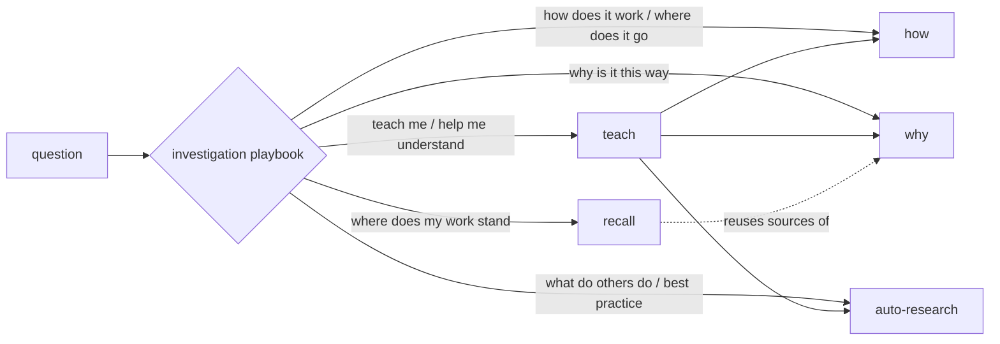

# Design: understand

Status: live, published at change pzsztlyw. Implements the `understand` decisions in
[`../intent.md`](../intent.md).

## Requirements

- **R1 Intent folders.** Sources live at `skills/<intent>/<skill>/SKILL.md`.
  Existing skills move: `understand/auto-research`, `verify/code-review`,
  `learn/evidence-learning-loop`, `operate/pi-delegate`,
  `tools/{jj,agent-browser,notion-mcp}`.
- **R1b Live install by symlink.** A second jj workspace at `~/.agents/src`
  holds the accepted version. `install.sh` links every installed path into
  it instead of copying: each skill flat as `~/.agents/skills/<skill>` and
  `~/.claude/skills/<skill>`, plus AGENTS.md, rules, playbooks, agents, and Pi
  config. It fails before linking if two intents hold the same skill name,
  backs up any non-link file it replaces, and removes dangling links that
  point into `~/.agents/src`. Going live: `jj -R ~/.agents/src new <change>`
  for a new accepted change; after rewriting the accepted change itself, the
  stable workspace goes stale and keeps serving the old files until
  `jj -R ~/.agents/src workspace update-stale`.
- **R2 Investigation playbook.** `skills/playbooks/investigation/SKILL.md` routes each
  question to one leaf; the AGENTS.md `investigation` row points to it.
- **R3 `how`.** Explains how code works and where things belong, for a target
  that defaults to the current repo and may be any local directory.
- **R4 `why`.** Recovers intent from jj history, committed intent/design
  docs, and my dated prompts, newest evidence winning.
- **R5 `recall`.** Briefs where a topic stands from recent session transcripts
  and jj state, with jj-based status tags.
- **R6 `teach`.** Paced explanation composed from `how`, `why`, and
  `auto-research`.
- **R7 `auto-research`.** External research only; its overnight loop moves to
  `skills/playbooks/long-run/SKILL.md`.
- **R8 jj everywhere.** The AGENTS.md VCS rule changes from "never initialize
  or convert" to: in a git-only repo, run `jj git init` (colocated by default
  in jj 0.43) and work in jj, using git only for read-only commands.

## Routing

`skills/playbooks/investigation/SKILL.md`, in full:

1. Pick the leaf from the table above; a question needing two leaves runs them
   in parallel and merges the answers.
2. Do not change the investigated code or VCS state. Only `auto-research`
   saves a report (see its section); other leaves answer in chat.
3. If the answer leads to a code change, stop and hand back to `bugfix` or
   `feature`.

Leaves never call each other, except `teach`, which composes.

## Skills

Each skill is model-invocable, so a playbook can load it by name; its
description names the question shape so it does not fire on unrelated asks.

### `how` (R3)

- **Scope check.** One module or narrow question: explore and answer directly.
  A subsystem spanning several files or services: split into 2–4 angles.
  When in doubt, direct.
- **Explore.** Angles run as read-only subagents (Claude Code: `Explore`; Pi:
  `worker` told read-only), each returning: components (`file:line`), flow,
  boundaries, non-obvious things, open questions.
- **Find files.** In a repo too large to read, start from the environment's
  code-search tool, then read only the hits.
- **Synthesize** in the main session: Overview, Key Concepts, How It Works
  (diagram when 3+ parts interact), Where Things Live, Gotchas. Drop empty
  sections. Mark unresolved gaps UNVERIFIED.

### `why` (R4)

- **Anchor.** Target lines plus their history: `jj file annotate`,
  `jj log -r 'files(<path>)'`, and `jj evolog` for a change that was reworked.
- **Sources, in order:** change descriptions; `docs/**/intent.md` and
  `design.md` touching the target; my prompts in this project's transcripts
  (paths under `recall`).
- **Recency.** Date every cited prompt. A later prompt, change, or doc
  overrides an earlier prompt; state each conflict as "on <date> you said X;
  <change> on <date> did Y".
- **Confidence.** Each claim is *stated* (a source says it), *inferred* (with
  the reasoning), or UNVERIFIED. List sources searched that returned nothing.

### `recall` (R5)

- **Scope first.** Window (default 7 days), topic, current project only; state
  it back before searching.
- **Transcripts.** Claude Code `~/.claude/projects/<cwd with / and _ as ->/*.jsonl`;
  Pi `~/.pi/agent/sessions/--<cwd with / as ->--/<ISO-time>_<id>.jsonl`.
  Order by modification time, grep the topic, read only matching regions,
  skip the current session. More than 3 matching sessions: fan out to
  subagents, one slice each.
- **Verify** every thread against live `jj log` / `jj status`.
- **Brief:** Capsule (≤5 bullets); Threads, each tagged `[pushed <bookmark>]`,
  `[local <change-id>]`, `[abandoned]`, or `[planned]`; Problems (≤5,
  including reverted attempts); Next move (one action).

### `teach` (R6)

- Choose the 2–3 things I should leave understanding, from why I'm asking.
- Run `how`, `why`, or `auto-research` as needed (in parallel), then explain:
  plain definition first, smallest complete answer, stop and let me steer.
- Build diagrams incrementally: each redraws the previous and adds one part.
- Keep `why`'s confidence wording intact.

### `auto-research` (R7)

- **Scope.** External sources only (web, papers, vendor docs), routed to
  `researcher`; a codebase sub-question goes back to the playbook for `how`.
- **Modes.** Quick (default, one round) or deep (several rounds, background).
  Longer than an hour runs under `skills/playbooks/long-run/SKILL.md`.
- **Report.** Findings with sources and access dates, UNVERIFIED marks, open
  questions.
- **Saving.** Only deep runs or on request: a repo-tied report goes in that
  repo's docs, any other in `~/notes/research/<YYYY-MM-DD>-<topic>.md`. The
  header records date, question, sources, and the jj change it was based on
  when repo-tied. A
  saved report is dated evidence: live code and newer evidence override it,
  and a `design.md` that relies on it restates the decision and cites it.

## Flagged concerns

1. **Symlink discovery.** Claude Code and Pi following symlinked skill
   directories and `CLAUDE.md` is UNVERIFIED; Plan step 1 checks it before
   anything else moves. Owner: installer.
2. **Transcript privacy.** `why` and `recall` read only the current project's
   transcripts, never another project's. Owner: both skills.

## Plan

1. R1 + R1b: link one test skill by hand and confirm Claude Code and Pi both
   list it; then create `~/.agents/src`, rewrite `install.sh` to link, move
   existing skills into intent folders; `./install.sh --dry-run` shows the
   same flat names as today.
2. R2 + R7: `skills/playbooks/investigation/SKILL.md` and its AGENTS.md row; move
   `auto-research`'s overnight loop into `skills/playbooks/long-run/SKILL.md`; trim
   `auto-research` to the section above.
3. R3–R6: one skill per change, each checked by running it on a real question
   in this repo (`how`: the installer; `why`: a recent change; `recall`: this
   reorg; `teach`: the installer).
